<h1 align="center">Hi, I'm Otávio 👋</h1>

  <b>Junior Back-end Developer</b> • C# / ASP.NET Core 
  I build APIs and web systems with a focus on clean code, good practices, and organization. 
  📍 Sorocaba, SP — Brazil

  
  

---

## 🚀 About me
- 💻 Back-end focus with **C# and ASP.NET Core**: REST APIs, business logic, and data persistence
- 🎓 Studying **Systems Analysis and Development** at Facens
- 🏢 Working in a corporate IT environment, where I learned to solve real problems and work with users and processes
- 🔭 Building my portfolio and looking for my first opportunity as a developer
- 🌱 Currently learning: software architecture, automated testing, and cloud (AWS)

## 🛠️ Tech Stack

**Back-end**

**Tools**

## 📂 Featured Projects
| Project | Description | Stack |
|---|---|---|
| **SchedulerSaaS** | Calendly-style SaaS scheduling platform | C#, ASP.NET Core |
| **BookIt** | Reservation and booking system | C#, ASP.NET Core |
| **FinanceTracker** | Personal finance management ecosystem | C# |
| **Face Mask Detection** | Mask detection using computer vision | Python |

## 🎮 GitHub Stats

  <picture>
    <source media="(prefers-color-scheme: dark)" srcset="https://raw.githubusercontent.com/TavinhoDeV/TavinhoDeV/output/pacman-contribution-graph-dark.svg">
    <source media="(prefers-color-scheme: light)" srcset="https://raw.githubusercontent.com/TavinhoDeV/TavinhoDeV/output/pacman-contribution-graph.svg">
    
  </picture>

